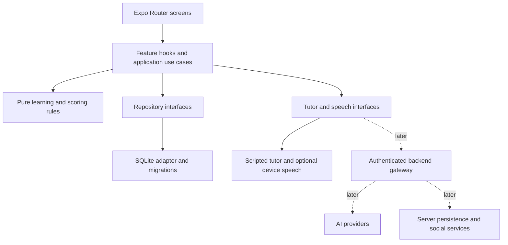

# Application architecture proposal

Priority update, 2026-10-16: the owner prioritizes natural multilingual AI speaking, with encrypted server-synced course downloads for offline learning and optional phone-only AI subject to feasibility. [Research, current capability matrix and reviewed-slice proposal](AI_SPEAKING_OFFLINE_PLAN.md) distinguish these requirements from the current implementation. No encryption, sync, streaming, native build, model download or deployment has been implemented by this planning update.

B5 update, 2026-10-15: [Local AI mode](PHASE_B5.md) now connects real recording → authenticated NestJS → FastAPI/Whisper/Qwen/TTS → SQLite and native speech playback orchestration. Automated real-service integration passed; the owner confirmed recognized speech, a real tutor reply and audible playback on Android. The remaining device checklist and iOS testing are open. Mock mode remains available. Earlier baseline descriptions below are historical.

Priority update, 2026-10-15: the owner has authorized Voice Tutor Phase A first. [VOICE_TUTOR.md](VOICE_TUTOR.md) records its implemented scope and next-phase NestJS boundary. The inspected baseline and lesson-first proposal below are historical; SQLite and a mock tutor now exist. No real voice pipeline is implemented.

Status: proposed for review, 2026-10-15. This document authorizes no application rewrite or service provisioning. See [roadmap](ROADMAP.md) and [data design](DATABASE_DESIGN.md).

## Inspected baseline

- Expo `~57.0.29`, React Native `0.86.3`, React `19.2.3`, TypeScript `~6.0.3` with strict mode.
- Expo Router entry point; `src/app/_layout.tsx`, `index.tsx`, and `explore.tsx` implement the starter. Native tabs and a separate web tab component already exist.
- Shared theme, themed components, animation, splash, icons, and safe-area support are present.
- npm and `package-lock.json`; no Bun lockfile. `node_modules` exists.
- No SQLite dependency or persistence implementation, backend, authentication, AI integration, test suite, ESLint configuration, or EAS configuration found in the inspected project.
- No tracked native projects: `ios/` and `android/` are absent and ignored.
- Preserve `app.json`, SDK versions, route entry point, scheme, icons, splash, automatic theme, typed routes, React Compiler setting, and existing web output during this planning task. Existing runtime health still requires device validation; source inspection is not a launch test.

## Proposed shape

One modular mobile application, with local persistence as the initial source of truth. Keep business rules independent of screens and provider SDKs. Add boundaries when their first feature needs them rather than scaffolding every future module.



The diagram describes the destination, not currently implemented components. No direct device connection to SQL Server or PostgreSQL. A future backend owns database access, authentication, authorization, provider secrets, quotas, and moderation.

## Proposed code organization

```text
src/
  app/                    # route screens and navigator layouts only
  components/             # shared accessible UI; reuse current theme components
  constants/              # existing theme and shared constants
  hooks/                  # existing shared UI hooks
  features/
    onboarding/           # native language, target language, study goal
    assessment/           # versioned questions and deterministic scoring
    learning/             # path selection, lessons, quizzes
    progress/             # target-specific history and summaries
    tutor/                # scripted sessions first; provider boundary
    settings/             # language switching and local data controls
  domain/                 # pure types and rules used by multiple features
  data/
    db/                   # connection lifecycle, ordered migrations
    repositories/         # interfaces and SQLite implementations
    content/              # validated, versioned bundled content
  services/               # platform/provider adapters introduced as needed
```

Dependencies flow from routes to features to domain/interfaces, with platform adapters composed at startup. Domain code imports neither React Native nor SQLite. Screens never execute SQL or call AI providers. Start with explicit imports, hooks, and React context for stable services/current preferences; do not add a global state library or ORM without demonstrated need. SQLite owns durable state; component state owns transient input. Refresh affected reads after commits.

## Languages and learning

Separate interface locale, native/explanation language, and active target language. A learner has one persistent learning profile per target language. Changing the native language changes explanations, not completed lessons; changing targets selects or creates a profile and never deletes the previous profile. Active sessions retain their original language/profile context until completed or cancelled.

Bundle a deliberately small supported catalog. Launch language pair(s) and explanation coverage require product selection before content work. Use language tags rather than display names as keys. Do not promise arbitrary language pairs without reviewed content and fallback behavior.

Start with a short, skippable placement check and an explicit beginner fallback. Store assessment evidence and scoring version; treat the result as a provisional learning recommendation, not a certified CEFR assessment. First path covers curated A1 material; higher estimates must not imply that unavailable A2-C2 courses exist. A deterministic rule selects the next available lesson using placement, prerequisites, completion, and review needs. CEFR alignment requires a content rubric and qualified review before making public claims.

## Tutor and media strategy

First MVP: a labeled scripted text practice tutor with curated bilingual feedback. No simulated response is represented as live AI, and no general-purpose mistake correction is claimed. Keep a narrow tutor interface for session input, response, correction references, cancellation, errors, and provider identity. Introduce streaming only when a real provider needs it.

Later, separate tutor persona from voice capability. Male/female tutor preferences must fall back gracefully when appropriate voices are unavailable; device voices and offline availability vary. Optional device text-to-speech is output only, not speech recognition or pronunciation scoring. Recording, transcription, speech evaluation, and real-time dialogue need separate technical and product validation. Do not claim these capabilities in the MVP. Add audio/video modules only when their milestone begins.

## Mobile quality and data boundaries

- Android and iOS are release targets. Preserve web starter compatibility; native SQLite web parity is not an MVP commitment. Provide an explicit web fallback/unsupported state when native persistence is introduced, rather than silently losing data.
- Respect safe areas, keyboard behavior, screen readers, large text, contrast, touch targets, RTL layout, interruptions, and light/dark themes. Use language autonyms; do not identify languages solely by flags.
- Use asynchronous storage access, bounded queries, and virtualized long lists. Avoid storing duplicate persistent state in contexts or rendering full conversation histories.
- Bundled lessons, quizzes, progress, and scripted practice work without a network. Optional voice output has a text fallback. Local storage survives app restarts but is not an account backup; uninstall/device loss can lose progress until export or sync is implemented.
- No provider keys in app bundles or `EXPO_PUBLIC_*`. No transcript/answer/recording logging by default. Plain SQLite is not encrypted storage. Add protected token storage only when authentication exists.
- Recording is opt-in with a visible indicator and retention/deletion policy. Future learner conversations require identity, blocking/reporting, moderation, and age/privacy decisions before rollout.

## Future backend and sync

Defer backend technology selection. Later use an authenticated API, stable client-generated IDs, versioned contracts, idempotent requests, and resumable sync. Server owns social membership and entitlements; device owns pending offline attempts. Preserve immutable attempts and merge by ID; resolve settings conflicts using an explicit policy, not device clocks alone. Add an outbox and tombstones only with a complete sync/deletion design. Anonymous-to-account linking must preserve local profiles.

## Recommended specialized Codex roles

These are suggested task roles, not agents launched or installed by this change. Start with four; one coordinating developer integrates reviewed work.

| Role | Ownership | Expected output |
| --- | --- | --- |
| Mobile UI and accessibility | Router screens, theme, device behavior | Small screen slices and Android/iOS accessibility evidence |
| Local data and migrations | SQLite, repositories, data invariants | Versioned migrations and persistence/recovery tests |
| Learning and content | Assessment, CEFR rubric, curated lessons | Reviewed fixtures, scoring rules, bilingual coverage; human content review remains necessary |
| Quality and release | Test strategy, regression, build readiness | Check results and device/release checklist |

Add an AI/speech integration role when evaluating a real provider, and a backend/sync/social role when those milestones begin. Assign bounded file ownership and shared contracts before parallel work; avoid concurrent edits to migrations, dependencies, or root layouts. Provider choice, costs, curriculum claims, and release approval stay with the project owner.

## Documentation basis

Verified against [Expo SDK 57](https://docs.expo.dev/versions/v57.0.0/), the [Expo documentation index](https://docs.expo.dev/llms.txt), [SDK 57 SQLite](https://docs.expo.dev/versions/v57.0.0/sdk/sqlite/), and [SDK 57 Speech](https://docs.expo.dev/versions/v57.0.0/sdk/speech/). SQLite is proposed, not installed. Recheck versioned documentation when implementation begins.
