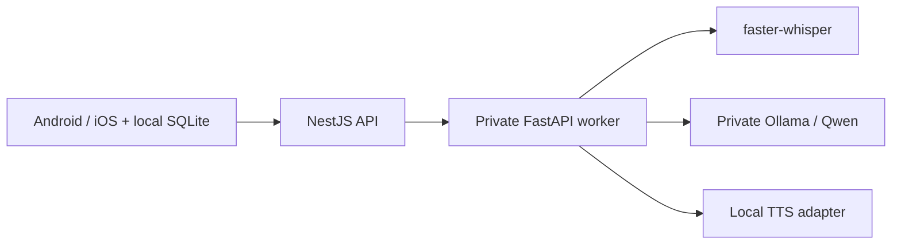

# Local AI services and Linux deployment preparation

## Scope and status

The mobile app calls NestJS, which authenticates/validates requests and calls an independent Python FastAPI worker. The worker owns faster-whisper, Ollama/Qwen and TTS adapters. [Phase B5](PHASE_B5.md) connects a separate Local AI mode to recording, transcription, Qwen, SQLite and real speech output. Schema 2 preserves Phase A records and isolates live/mock sessions. Automated integration passed; the owner confirmed the core voice flow with audible speech on Android. Remaining device-checklist items and iOS testing are open. Phase A mock conversations remain available.

No infrastructure has been deployed. Docker is not installed on this Windows PC: Compose, images, Caddy, Ubuntu and CUDA configuration have only static validation, not runtime verification. Production configuration is preparation, not release certification.



## Windows prerequisites and startup

Inspected hardware: Windows 11 Pro, Intel Core 7 150U (10 cores / 12 threads), approximately 31.7 GiB RAM, integrated Intel graphics. Only about 6.9 GiB RAM was free during inspection; close memory-heavy applications. Node 24.22 and Python 3.13.7 are installed. Use CPU/int8 Whisper small and Qwen3 1.7B initially; CUDA is not available on this Intel GPU. Node/Python environments are separate from Expo.

The owner approved both model downloads. Whisper small is in `services/ai/models/whisper-small`; the verified official portable Ollama runtime is in `services/runtime/ollama`; Qwen is in `services/runtime/ollama-models`. These ignored directories, recordings and generated `.env` secrets are not source artifacts. No global Ollama installer or paid API is required.

For a fresh checkout, from the repository root:

```powershell
npm.cmd ci
npm.cmd ci --prefix services/api
python -m venv services/ai/.venv
& services/ai/.venv/Scripts/python.exe -m pip install -r services/ai/requirements.txt
& services/ai/.venv/Scripts/python.exe scripts/init-local-services.py
npm.cmd run build --prefix services/api
```

The initialization script refuses to overwrite existing secrets. Three distinct random credentials are generated: device development access, worker service access, and monitoring access. Only the device credential belongs in the lab's masked token field; never put internal tokens in mobile source, `EXPO_PUBLIC_*`, screenshots or logs. For production, use short-lived JWT access tokens from a configured identity provider, not the development shared token.

Model provisioning is explicit, never application startup behavior. On another machine, inspect model licenses and obtain approval before using `scripts/provision-local-models.py --help` or downloading assets. The current Whisper revision is recorded by the provisioning script; Ollama archive SHA-256 was verified against its official release metadata. Copying the model directories requires copying their license/provenance records too.

Start Ollama in a dedicated terminal from the repository root (skip if already running):

```powershell
$env:OLLAMA_HOST='127.0.0.1:11434'
$env:OLLAMA_MODELS=Join-Path (Get-Location) 'services/runtime/ollama-models'
$env:OLLAMA_NO_CLOUD='1'
$env:OLLAMA_MAX_LOADED_MODELS='1'
$env:OLLAMA_NUM_PARALLEL='1'
& services/runtime/ollama/ollama.exe serve
```

In two other terminals, start the worker and gateway respectively:

```powershell
Set-Location services/ai
& .venv/Scripts/python.exe -m app.run
```

```powershell
Set-Location services/api
npm.cmd start
```

All listeners default to loopback. For phone testing, set **only** `API_HOST` in `services/api/.env` to the PC's current private Wi-Fi IPv4 address. The inspected address was `192.168.1.49`; verify it with `ipconfig` because DHCP can change it. Keep worker port 8000 and Ollama port 11434 on `127.0.0.1`. Permit port 3000 through Windows Firewall only for the private network as needed. Never forward these ports on the router.

Copy root `.env.example` to `.env` and set `EXPO_PUBLIC_API_BASE_URL=http://<PC-private-IP>:3000`, then run `npm.cmd start`. Phone and PC must share the private network. In Expo Go, open the separate B1 audio lab, enter the device access token from the gateway's local `.env`, record a short English phrase, stop, replay, and upload. Transcription should appear in the lab. Retry after correcting a connection/permission problem; cancelling aborts the mobile request. CPU inference may take tens of seconds; the upload deadline is 130 seconds. HTTP development tokens travel unencrypted on this trusted LAN, so use HTTPS for broader access and production. iOS/local-network permission, Android permissions and actual phone playback/upload remain device checks, not conclusions from server tests.

## Contracts and configuration

Endpoints behind gateway authentication:

| Route | Purpose |
| --- | --- |
| `GET /health/live` | Process liveness; no secrets/model details |
| `GET /health/ready` | Authenticated readiness, model/voice provisioning |
| `GET /v1/voices` | Actual available voice IDs/languages/genders |
| `POST /v1/audio/transcriptions` | Multipart `audio`, `nativeLanguage`, `targetLanguage`, `durationMs` |
| `POST /v1/tutor/respond` | Text, native/target language, CEFR, correction mode, bounded context |
| `POST /v1/corrections` | Structured correction feedback |
| `POST /v1/audio/speech` | Text, language, supported voice ID; returns WAV |
| `GET /metrics` | Separate monitoring credential; never public |

Language codes currently accepted: `en`, `hi`, `es`. Schema validation bounds text/context/file sizes. Models support these languages, but Hindi/Spanish recognition, mixed-language accuracy and CEFR teaching quality have not been validated on a representative learner corpus. Whisper auto-detects language; it does not guarantee code-switching accuracy. No pronunciation score is inferred from transcription. A Hindi explanation must contain Devanagari or the service returns a clear upstream failure; this script check is not full linguistic quality validation.

Use `services/api/.env.example`, `services/ai/.env.example`, and `infra/.env.example` as configuration references. All service URLs, secrets, models, device/compute type, timeouts, limits and binding addresses are environment-configured. Run one Python worker per model/device to avoid duplicated RAM/VRAM. Gateway defaults: 30 requests/minute per authenticated principal, two active requests; worker defaults: one active AI task, four CPU threads, 120-second deadline, 10 MiB upload and 60-second audio limit. A timed-out native inference retains its concurrency slot until its thread actually completes. No inference POST is automatically retried; only connection establishment or safe GETs have bounded retries. Users may explicitly retry after an error.

Production authentication validates JWT signatures via HTTPS JWKS, issuer, audience, expiry and `tutor:use` scope. Identity/account issuance is not implemented here. Gateway and worker use different credentials. In-memory rate limiting is per process; multiple replicas need a shared limiter such as Redis and trusted ingress policy. This prototype is not a completed account/security platform.

## Models, voices and licenses

Qwen3 1.7B is Apache 2.0; the selected Systran converted Whisper small is MIT. Verify upstream revisions and retain notices when distributing. Piper's current engine is GPL 3.0; each voice has its own model/dataset license. Do not assume engine licensing covers voice assets.

Windows development uses installed System.Speech voices, discovered at runtime: English David (male), Hazel and Zira (female) on this PC. Real nonempty WAV generation was tested. These Windows voices are not bundled, not portable Linux assets, and are blocked by production configuration. No Hindi or Spanish voice is advertised unless actually installed/discovered.

Linux uses Piper. `services/ai/voices.json` deliberately starts empty: no Linux production voice has been cleared/downloaded. Some researched Hindi/English voices have noncommercial datasets or unresolved provenance. Before enabling a voice, review commercial/distribution terms, record its exact revision and license, obtain the model and matching `.onnx.json`, and add an approved catalog entry:

```json
[{"id":"reviewed-en","language":"en","gender":"female","label":"Reviewed voice name","model":"voices/reviewed.onnx","license":"actual reviewed license identifier","revision":"actual upstream revision","approved":true}]
```

Paths must remain under `AI_MODEL_ROOT`. Do not mark a voice approved until review is complete. Install Piper with `requirements-models.txt` when needed (Docker `INSTALL_AI_RUNTIMES=1`); the frozen base requirements already include Whisper. Readiness stays false when live assets/voices are unavailable. Fixture mode returns explicitly labeled text and a tone, never simulated successful speech recognition. Production rejects fixtures and Windows SAPI.

Sources: [Qwen3 release and languages](https://qwenlm.github.io/blog/qwen3/), [Ollama Qwen3 tags](https://ollama.com/library/qwen3/tags), [Whisper small model card](https://huggingface.co/Systran/faster-whisper-small), [faster-whisper](https://github.com/SYSTRAN/faster-whisper), [Piper](https://github.com/OHF-Voice/piper1-gpl). Review these again before deployment; availability/licensing can change.

## Docker development and Ubuntu production preparation

Docker Desktop/Engine is missing locally; no Docker installation, build or deployment was performed. Install a suitable Docker/Compose environment yourself after checking its license and requirements. For Ubuntu use the [official Docker Engine installation guide](https://docs.docker.com/engine/install/ubuntu/) and Compose plugin. The Docker group grants substantial host privileges; restrict operator membership.

From the repository root, development configuration validation/build commands are:

```bash
docker compose --env-file infra/.env -p speak-dev -f infra/compose.yaml -f infra/compose.dev.yaml config --quiet
docker compose --env-file infra/.env -p speak-dev -f infra/compose.yaml -f infra/compose.dev.yaml build
```

Development publishes only NestJS on `DEV_BIND_IP` (loopback default); AI ports have no host mapping. Provisioning needs outbound networking; the development overlay permits that. Named `ai_models` and `ollama_models` volumes survive container replacement. Provision Whisper/Piper files into `ai_models` at the configured paths, rebuild the reviewed voice catalog into the worker, and copy the approved Ollama model store into the `ollama_models` volume's `models` directory. Use a temporary maintenance container with only the required volume mounted writable, then remove it. Keep model volumes read-only to the running Python service; ensure files are readable by the image's nonroot UID. Do not run `down -v` against persistent assets.

For an **approved future Ubuntu deployment**:

1. Provision a patched Ubuntu LTS server, restricted SSH keys and host firewall. Allow HTTPS 443 and ACME HTTP 80; never allow worker/Ollama ports. Restrict SSH to operators.
2. Install Docker/Compose from official sources. Pin tested image digests and dependency/model revisions; scan images and review GPL/voice obligations. Current image tags are preparation defaults, not immutable production digests.
3. Copy reviewed source and generated production secrets securely; restrict `.env` permissions. Set `APP_ENV=production`, `AUTH_MODE=jwt`, `AI_MODE=live`, real HTTPS issuer/JWKS/audience, DNS domain and ACME email. Configure an identity provider issuing `tutor:use`; there is no built-in login server.
4. Populate persistent models and reviewed Piper voices before declaring readiness. The production inference network has no outbound access. Downloading models is a separate approved maintenance step, not runtime behavior.
5. Use **base + production only**, never add the development overlay (merged port publications could otherwise remain). Validate without printing expanded secrets:

```bash
docker compose --env-file infra/.env -p speak-prod -f infra/compose.yaml -f infra/compose.prod.yaml config --quiet
docker compose --env-file infra/.env -p speak-prod -f infra/compose.yaml -f infra/compose.prod.yaml build
```

6. After owner approval, the operator may start the reviewed stack with the same arguments and `up -d`. This document does not authorize executing that command now.
7. Verify public DNS/TLS, authentication failures, rate/concurrency limits, readiness internally, upload/correction/TTS from a real device, restart persistence, monitoring, restore procedure and port isolation before release. Caddy automatically obtains/renews HTTPS certificates for a valid domain; persist its data/config volumes. Its public proxy blocks internal metrics/readiness/docs. See [Caddy automatic HTTPS](https://caddyserver.com/docs/automatic-https).

The private inference network connects only API, worker and Ollama. Caddy joins only the edge network. Development Compose must not be reused as the production overlay. Production JWT discovery needs controlled outbound HTTPS from the gateway. Persistent volumes are not backups: schedule encrypted backups, restore drills and retention policies for configuration and any future shared learner store. AI transient uploads are worker-owned temporary files, not a server transcript database.

## Resources, monitoring and future scaling

Sizing below is an initial estimate, not a load-test guarantee:

| Resource | CPU prototype / small single-conversation pilot |
| --- | --- |
| CPU | 4 threads for AI; 8 modern host cores preferred |
| RAM | 16 GiB host minimum estimate; 32 GiB preferred with development tools |
| GPU | None required for CPU/int8; optional supported NVIDIA GPU, roughly 8–12 GiB VRAM as a starting budget |
| Storage | At least 20 GiB free for runtimes/models/builds; 50+ GiB production headroom and backups |
| Network | Private LAN development; reliable HTTPS internet for production users |

The approved downloads total about 0.5 GB Whisper + 1.4 GB Qwen + 1.4 GB portable Ollama archive, plus extracted runtimes/caches and dependencies. A 128-kbit/s recording is about 1 MB/minute before overhead; PCM WAV can be larger. Upload and generated audio are individually bounded to 10 MiB, so budget up to roughly 20 MiB/turn plus protocol/text overhead at those limits. Measure actual audio formats and concurrent load before sizing bandwidth.

Use protected `/metrics` for worker process RSS/CPU, in-flight work, requests/errors; gateway metrics use a separate monitor credential. Supplement with `docker stats`, disk/volume monitoring and NVIDIA tools on a GPU host. Alert on OOM/restarts, low disk, queue rejection (429), inference timeouts, unavailable voices/models, authentication failures and latency percentiles measured by private monitoring. Do not log tokens, audio or learner text. Health probes indicate process/model availability, not pedagogical correctness.

For a dedicated GPU worker later, move Python/Ollama/model volumes together behind a private VPN/VPC, set `AI_SERVICE_URL` on NestJS and `OLLAMA_URL` on Python, and use internal TLS/mTLS plus rotated service credentials. Configure trusted CA roots rather than disabling verification. Do not expose remote AI ports publicly. `infra/compose.gpu.yaml` and the CUDA Dockerfile are untested templates requiring NVIDIA Container Toolkit, compatible drivers/CTranslate2 and measured VRAM. They are not suitable for this Intel GPU.

Mobile SQLite continues storing local history. Cross-device synchronization, accounts and social/group learning require an authenticated shared backend datastore, durable IDs, sync conflict rules and authorization/moderation. No central SQL Server/PostgreSQL store or sync protocol was introduced in this slice.

## Repeatable validation

Recorded outcomes and limitations are in [LOCAL_AI_TEST_RESULTS.md](LOCAL_AI_TEST_RESULTS.md).

From root, unless stated otherwise:

```powershell
npm.cmd test
npm.cmd run lint
npm.cmd run typecheck
npm.cmd test --prefix services/api
npm.cmd run typecheck --prefix services/api
& services/ai/.venv/Scripts/python.exe scripts/validate-service-config.py
& services/ai/.venv/Scripts/python.exe scripts/test-local-services.py
& services/ai/.venv/Scripts/python.exe scripts/test-live-models.py
& services/ai/.venv/Scripts/python.exe scripts/test-local-services.py --live
```

Worker unit/integration tests (run inside `services/ai`): `.venv/Scripts/python.exe -m unittest discover -s test -v`.

Fixture HTTP tests start temporary loopback services and clean up their own processes. Live tests additionally require approved models, running local Ollama, installed voices and a synthetic `models/test-hello.wav`. They do not upload personal recordings or prove phone recording/playback. Whisper/PyAV compatibility required `av>=14,<16` with the tested faster-whisper runtime; the frozen requirements capture the working environment.

Remaining acceptance work includes Docker builds/Compose runtime, Linux/Piper assets, HTTPS/JWT with an actual identity provider, Hindi/Spanish and mixed-speech corpus tests, human evaluation of Qwen feedback, physical Android/iOS end-to-end playback and B5 UI/persistence integration. Do not claim these are complete from fixture or synthetic tests.
